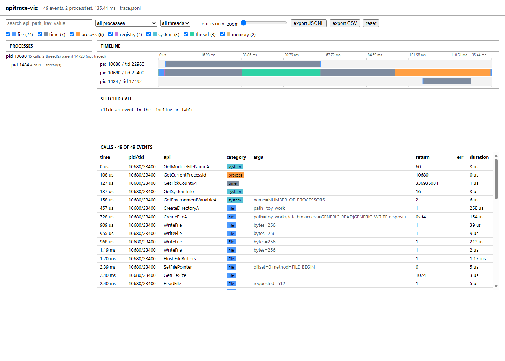

# apitrace-viz

A small Windows program that logs its own Win32 calls to a JSON-lines file, and a Node script that turns such a file into a single self-contained HTML page with a swimlane timeline.

The tracer is not a hook or a monitor. `tracer/trace.h` is a wrapper that the program calls its APIs through, so only calls written in that program show up. It does not attach to, inject into or watch any other process.

## Build and run

You need CMake and a C++17 compiler on Windows (tested with MinGW-w64 g++ 14.2 and Ninja), plus a recent Node (CI uses 22, I developed on 26) for the visualizer. There are no npm dependencies.

    cmake -S . -B build -G Ninja
    cmake --build build
    cd build
    toy.exe trace.jsonl

The toy creates and deletes a `toy-work` folder in the current directory, reads (only) a registry key under `HKLM\SOFTWARE\Microsoft\Windows NT\CurrentVersion`, starts a worker thread, and launches a second copy of itself as a child process that writes a small file. All of that ends up in `trace.jsonl`.

Then:

    node viz/cli.js trace.jsonl -o trace.html

`samples/trace.jsonl` is a real run of the toy (49 events, two processes), so you can skip the build:

    node viz/cli.js samples/trace.jsonl -o samples/trace.html

The page has a lane per process/thread pair coloured by API category, a process tree, a text search over api names, arguments and return values, category / process / thread filters, an errors-only toggle, a zoom slider, a detail pane for the selected call, and a call table. "export JSONL" and "export CSV" write only what the current filters leave visible.

## Trace format

One JSON object per line:

    {"ts":1791999566491943,"pid":10680,"ppid":14720,"tid":23400,"api":"CreateFileA","cat":"file","args":{"path":"x"},"ret":"0xf0","err":2,"dur_us":52}

`ts` is Unix time in microseconds, `dur_us` the call duration, `err` is `GetLastError()` after the call. `ts`, `api` and `pid` are required; everything else has a default. Lines that are not valid JSON or miss a required field are skipped and listed at the top of the page (and on stderr from the CLI). Events are sorted by `ts` on import, since a call is written when it returns and threads can finish out of order.

## Tests

    npm test

or `node --test "viz/test/*.test.js"`. They cover the importer (including broken lines), the filters, the exports and the generated HTML. There are no tests for the C++ side beyond the sample trace being importable; CI builds it and runs the toy.

## Limits

- The page has only been looked at in Edge (headless), not in Firefox, and has no automated browser test.
- Parent and child write to the same file with one append per line. That is fine for this toy but I have not tested heavy concurrent writing.
- Only about 40 call sites are wrapped, with hand-written argument descriptions. Adding an API means adding a `TRACED(...)` line.
- The HTML embeds all events, and the call table stops at 2000 rows. Traces of hundreds of thousands of events will be slow.
- The registry key, paths and ANSI (`A`) calls are all that the toy covers. No network or wide-char APIs.
- Windows only for the tracer; the visualizer runs anywhere.

MIT licensed.
